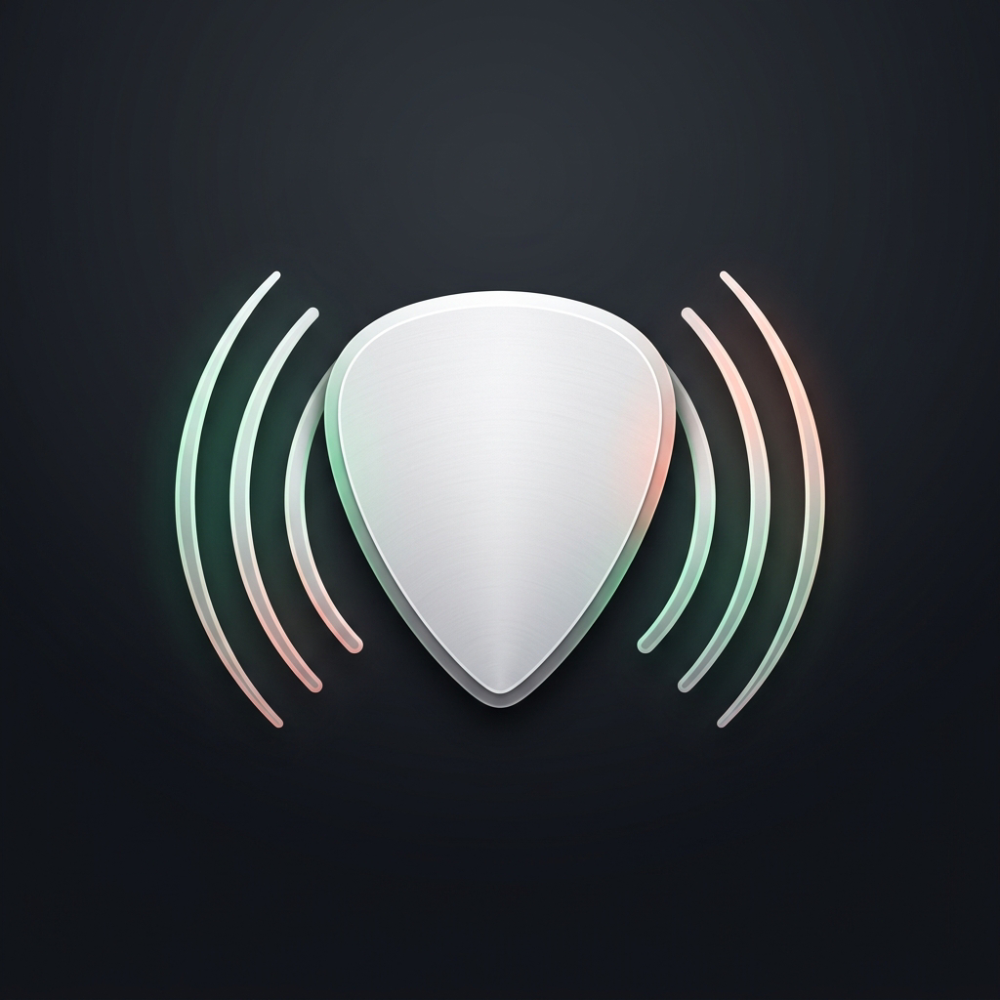
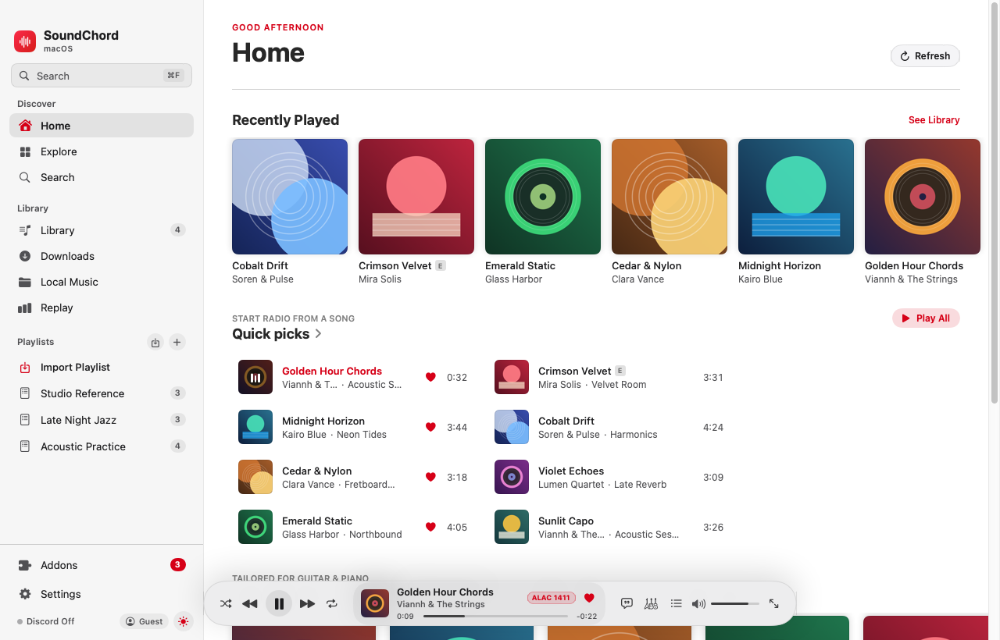
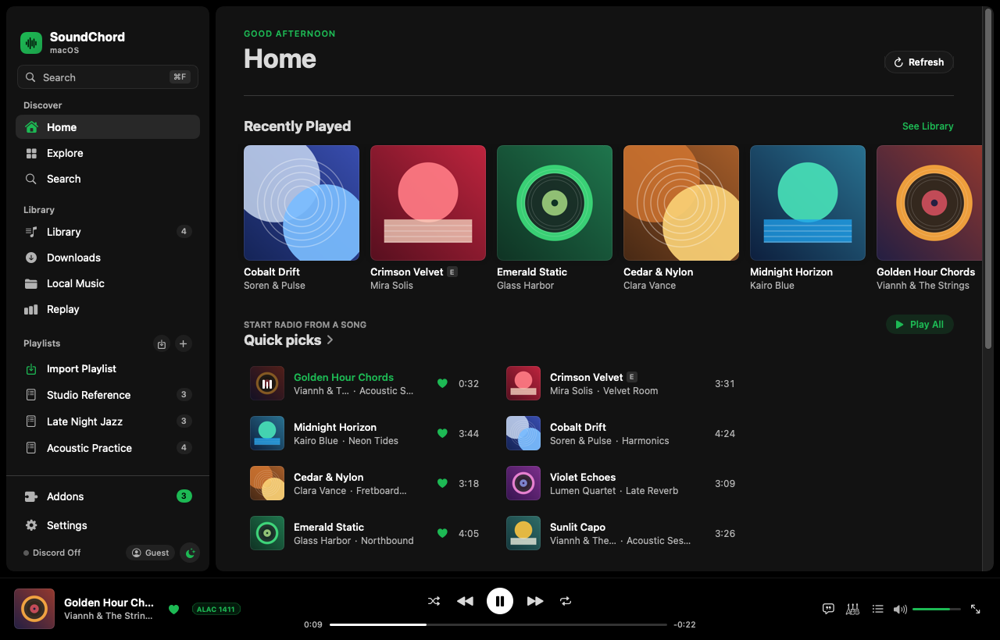
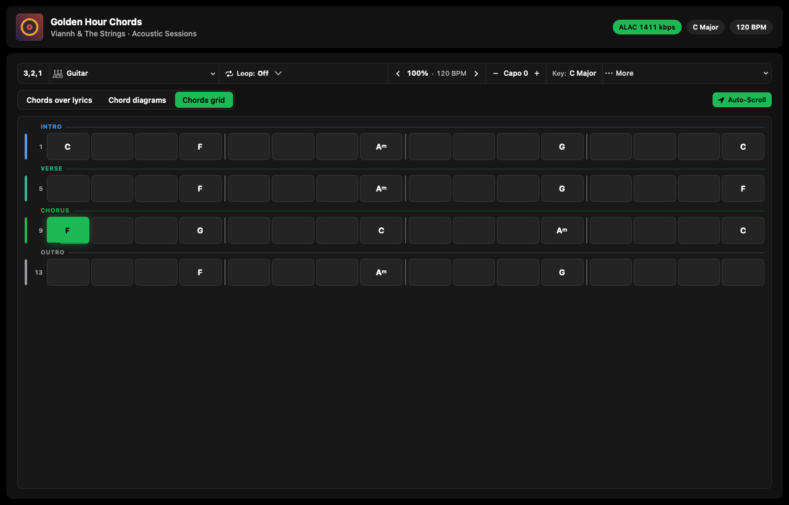
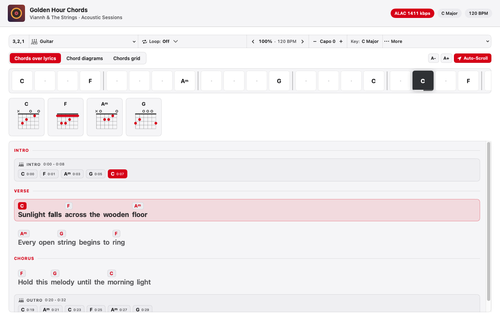
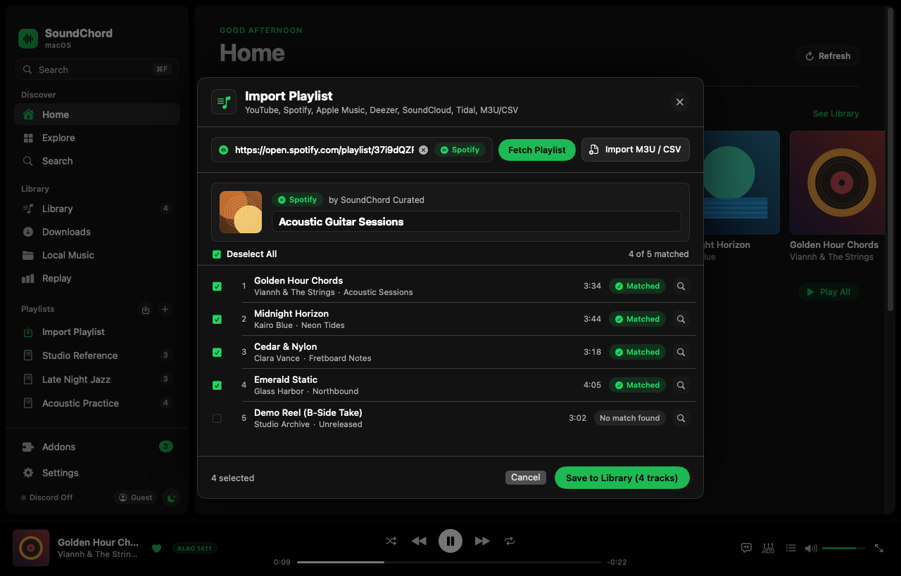
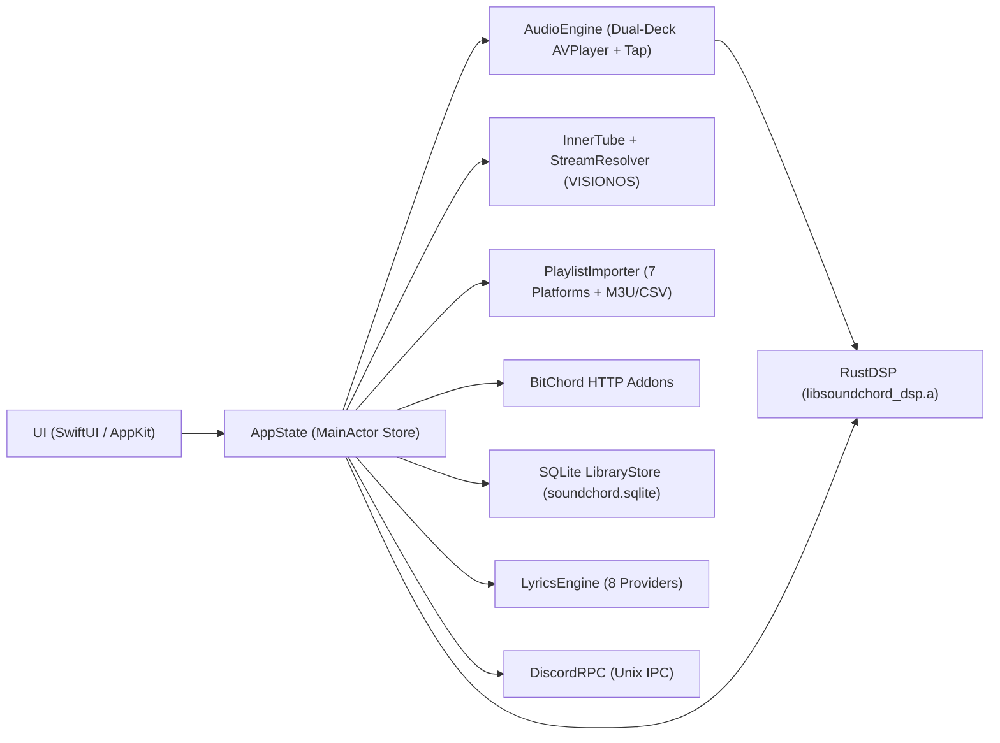

<p align="center">
  
</p>

<h1 align="center">SoundChord</h1>

<p align="center">
  Native macOS 15+ music player and real-time Chordify-style chord companion built with SwiftUI, AppKit, AVFoundation, and a zero-dependency Rust DSP engine.
</p>

<p align="center">
  
  
  
  
</p>

<p align="center">
  <a href="#screenshots">Screenshots</a> &middot;
  <a href="#features">Features</a> &middot;
  <a href="#rust-dsp-chordify-pipeline">Chordify Pipeline</a> &middot;
  <a href="#multi-platform-url-playlist-importer">Playlist Importer</a> &middot;
  <a href="#architecture">Architecture</a> &middot;
  <a href="#quick-start">Quick Start</a> &middot;
  <a href="#keyboard-shortcuts">Shortcuts</a> &middot;
  <a href="#credits-license--attribution">Credits</a> &middot;
  <a href="#donate--support">Support</a>
</p>

---

SoundChord is created and maintained by **Viannh** (`https://github.com/Viannh/SoundChord`) under GNU GPLv3, inspired by [BitChord](https://github.com/kushagrasinghx/BitChord). It combines YouTube Music discovery and streaming, local audio playback, an on-device Rust DSP chord and beat-grid analyzer, a synced Lyrics+Chords sheet, a multi-platform URL playlist importer, BitChord HTTP Addons support for lossless audio, and native Discord Rich Presence.

---

## Screenshots

<table>
  <tr>
    <th width="50%">Apple Music Light Mode</th>
    <th width="50%">Spotify Dark Mode</th>
  </tr>
  <tr>
    <td>
      
    </td>
    <td>
      
    </td>
  </tr>
  <tr>
    <td>
      <code>#FFFFFF</code> canvas, <code>#F5F5F7</code> vibrancy sidebar (<code>NSVisualEffectView</code>), <code>#D60017</code> Apple Red accents, and a floating glass capsule bar.
    </td>
    <td>
      <code>#000000</code> outer frame, <code>#121212</code> rounded panels, <code>#1DB954</code> Spotify Green accents, and a docked full-width <code>80pt</code> solid black bar.
    </td>
  </tr>
</table>

---

## Rust DSP Chordify Pipeline

SoundChord analyzes tracks locally on-device using `RustDSP` (`libsoundchord_dsp.a`), a zero-dependency pure Rust static library implementing Radix-2 Cooley-Tukey FFT, 12-bin harmonic-weighted log-magnitude chroma with bass-register root boosting, spectral-flux onset autocorrelation BPM/meter estimation, Viterbi HMM chord decoding (`Simple Maj/Min` and `Extended +7th`), beat-grid quantization, section boundary detection, and Krumhansl-Schmuckler global key estimation.

<table>
  <tr>
    <th width="50%">Chords Grid (Dark Mode)</th>
    <th width="50%">Chords Over Lyrics (Light Mode)</th>
  </tr>
  <tr>
    <td>
      
    </td>
    <td>
      
    </td>
  </tr>
  <tr>
    <td>
      7-cell practice toolbar (<code>3,2,1</code> count-in, Guitar/Piano instrument, A-B Loop, tempo <code>%</code> &amp; BPM, <code>Capo -6..+6</code>, Key, More) and 4-bars-per-row grid with color-coded section edge tabs (<code>Intro</code>, <code>Verse</code>, <code>Chorus</code>, <code>Outro</code>).
    </td>
    <td>
      Single-row <code>54x52</code> beat strip, unique Guitar fretboard &amp; 2-octave Piano chord strip, <code>A-</code>/<code>A+</code> lyric scaling, section headings, and chord badges aligned above exact synced words.
    </td>
  </tr>
</table>

### Progressive 3-Tier Chord Analysis Flow

```text
SQLite cache (0 ms) -> Live MTAudioProcessingTap -> Compact stream (itag 139/140 prefix) -> Full beat grid & Lyrics+Chords
```

1. **Tier 0 (`LibraryStore` SQLite Cache)**: Checks `chord_timelines` in `soundchord.sqlite` on track change so previously analyzed tracks load immediately.
2. **Tier 1 (Real-Time Audio Tap)**: Feeds live playback PCM buffers through `ChordDetector` (`sc_realtime_*`) with EMA smoothing, RMS silence gating, and hysteresis hold frames while offline analysis runs.
3. **Tier 2 (Fast Prefix Pass)**: For streamed YouTube Music tracks without a cached timeline, fetches a compact `itag 139 -> 140` progressive prefix (`VISIONOS` client) and publishes a partial `TrackChordTimeline` as soon as the first audio chunks arrive.
4. **Tier 3 (Full Beat Grid & Lyrics+Chords)**: Decodes the complete track at 22,050 Hz mono PCM, computes beat-aligned `BeatChordCell` bars, `SongSection` markers, and global key, caches the result to SQLite, and aligns chords onto word-synced, line-synced, or plain lyrics via `LyricsChordAligner`.

---

## Multi-Platform URL Playlist Importer

Import public playlists or exported playlist files directly into your local SoundChord library and match them concurrently against YouTube Music with manual search fallback per track.

<p align="center">
  
</p>

| Platform / Format | URL / Input Support | Extraction Method |
| :--- | :--- | :--- |
| **YouTube / YouTube Music** | `music.youtube.com/playlist?list=...`, `youtube.com`, `youtu.be` | Direct `InnerTubeClient` `browse` extraction (pre-matched) |
| **Spotify** | `open.spotify.com/playlist/...`, `open.spotify.com/album/...`, `spotify:` URI | Embed `__NEXT_DATA__` JSON parser + catalog matching |
| **Apple Music** | `music.apple.com/.../playlist/...`, `music.apple.com/.../album/...` | Public page JSON-LD `MusicPlaylist` / `MusicAlbum` parser |
| **Deezer** | `deezer.com/playlist/...`, `deezer.com/album/...`, `dzr.page.link` | Public Deezer API JSON extraction |
| **SoundCloud** | `soundcloud.com/.../sets/...` | Page `__sc_hydration` JSON state extraction |
| **Tidal** | `tidal.com/browse/playlist/...`, `listen.tidal.com/...` | JSON-LD extraction with M3U/CSV fallback guidance when gated |
| **Local M3U / CSV** | `.m3u`, `.m3u8`, `.csv` (including Exportify UTF-8 CSV) | Local file parser with track/artist/album/duration matching |

---

## Features

- **2-Direction Theme System (Apple Music Light / Spotify Dark)**
  - Switch between **System**, **Apple Music Light**, and **Spotify Dark** from Settings or the sidebar footer toggle.
  - Light Mode uses `NSVisualEffectView` vibrancy exclusively on the sidebar (`.sidebar`) and floating bottom capsule (`.hudWindow`); Dark Mode uses solid `#000000` outer chrome, `#121212` panels, `#181818` cards, and a docked `80pt` solid `#000000` player bar.
  - Full-Screen Now Playing view pairs a 4-color animated artwork `MeshGradient` backdrop with synced lyrics, an isolated Chord Studio card, and the Up Next queue.
- **YouTube Music Integration (`InnerTubeClient` & `StreamResolver`)**
  - Home, Explore, live Search with debounced suggestions and category filters, plus full Album, Artist, and Playlist detail views.
  - Multi-client audio stream resolution (`VISIONOS` `0.1` / `1.02`, `IOS` HLS fallback, `ANDROID_VR`, `WEB_REMIX`) with a `1 MiB` YouTube CDN auth boundary probe (`64 KiB` range verification) and JavaScriptCore cipher fallback.
  - Optional YouTube Music cookie sign-in for personalized Home feeds and private playlists.
- **BitChord HTTP Addons Ecosystem**
  - Compatible with the BitChord HTTP Addon protocol (`Resonance`, `ReZenOnance`, `Tido`, and self-hosted `Plex / Jellyfin / Emby / Navidrome` bridges) for Hi-Res FLAC search and automatic lossless substitution.
- **Native Audio Engine (`AVFoundation` / `AVAudioEngine`)**
  - Dual-deck **crossfade** (0 to 12 seconds), gapless queue preloading, shuffle, repeat (Off / All / One), playback speed (`0.5x` to `2.0x`), stereo L/R balance, loudness normalization, A-B practice loop, `3,2,1` count-in, and sleep timer.
  - **7-Band Graphic Equalizer** (`60Hz`, `150Hz`, `400Hz`, `1kHz`, `2.4kHz`, `6kHz`, `15kHz`, +/-12 dB) with 16 presets.
  - **macOS Media Keys & Control Center** (`MPNowPlayingInfoCenter` & `MPRemoteCommandCenter`), AppleScript/JXA Cocoa Scripting (`SoundChord.sdef`), and **Stats for Nerds** (`⌘I`) stream telemetry popover.
- **Multi-Provider Word-Synced Lyrics**
  - Concurrent race across `lrc.red`, `BiniLyrics`, `BetterLyrics`, `LyricsPlus`, `LRCLIB`, `KuGou`, `YouTube Music`, and `Genius` with customizable provider order, per-track timing offset (`-0.5s` / `+0.5s`), and line translation.
- **Offline Downloads, Local Music & Replay Stats**
  - Download tracks locally, scan macOS audio folders (`.m4a`, `.mp3`, `.flac`, `.wav`, `.aiff`, `.alac`), view listening stats, and export/restore JSON library backups.
- **Native Discord Rich Presence**
  - Pure-Swift connection to Discord's local Unix domain IPC socket (`discord-ipc-0..9`) with no external helper daemon required.

---

## Architecture



---

## Requirements

- **OS**: macOS 15.0 (Sequoia) or later
- **Architecture**: `x86_64` (Intel / AMD64; builds from source on Apple Silicon as well)
- **Building from source**:
  - Apple Command Line Tools (`swift` 6.0+ / macOS 15 SDK)
  - Rust toolchain (`cargo` & `rustc` stable, with `x86_64-apple-darwin` target)

---

## Quick Start

### Option 1: Install from `.dmg`

1. Open `dist/SoundChord-macOS-x86_64.dmg`.
2. Drag **SoundChord.app** into your **Applications** folder.
3. **First Launch (Gatekeeper / Ad-Hoc Signed Build)**:
   Because local releases are ad-hoc signed rather than notarized with an Apple Developer ID, macOS Gatekeeper may warn on first open. Use either method:
   - **Finder**: Right-click (or Control-click) `SoundChord.app` in `/Applications` -> select **Open** -> click **Open** in the confirmation dialog.
   - **Terminal**: Remove the quarantine attribute before launching:
     ```bash
     xattr -cr /Applications/SoundChord.app
     open /Applications/SoundChord.app
     ```

### Option 2: Build from Source

1. Build and test the Rust DSP static library:
   ```bash
   cd RustDSP
   cargo test
   cargo build --release --target x86_64-apple-darwin
   cd ..
   ```
2. Build and test the macOS app with SwiftPM:
   ```bash
   swift build
   swift test
   ```
   Or compile the release binary, render `AppIcon.icns`, assemble `dist/SoundChord.app`, and produce `dist/SoundChord-macOS-x86_64.dmg` in one step:
   ```bash
   ./Scripts/build_app.sh
   ```

> **Note**: If building inside a restricted sandbox where `/var/folders/.../clang/ModuleCache` is read-only, `./Scripts/build_app.sh` automatically configures sandbox-safe caches in `/tmp`.

---

## Keyboard Shortcuts

| Shortcut | Action |
| :--- | :--- |
| `Space` | Play / Pause (when not typing in a text field) |
| `⌘ →` | Next Track |
| `⌘ ←` | Previous Track |
| `⌘ ↑` / `⌘ ↓` | Volume Up / Volume Down |
| `⌥ ⌘ M` | Mute / Unmute |
| `⇧ ⌘ S` | Toggle Shuffle |
| `⇧ ⌘ R` | Cycle Repeat Mode |
| `⌘ F` | Open Search |
| `⌘ L` | Toggle Synced Lyrics Drawer |
| `⌘ U` | Toggle Up Next Queue Drawer |
| `⌘ K` | Toggle Chords Drawer |
| `⇧ ⌘ F` | Toggle Full-Screen Now Playing |
| `⌘ I` | Toggle Stats for Nerds |
| `Esc` | Close Full-Screen Player, Import Sheet, or Stats Popover |

Hardware macOS media keys (`Play/Pause`, `Next`, `Previous`) and Control Center Now Playing controls are also supported system-wide.

---

## YouTube Music Cookie Sign-In (Optional)

SoundChord works out of the box in **Guest Mode** with no login required. To unlock personalized Home recommendations and access private playlists:

1. Sign in to [music.youtube.com](https://music.youtube.com) in your browser.
2. Open **Developer Tools** -> **Network** tab and select any `youtubei/v1/browse` request.
3. Copy the full value of the **`cookie`** request header (containing `SAPISID` / `__Secure-3PAPISID`).
4. In SoundChord, open **Settings -> Account**, paste the cookie header, and click **Save & Refresh Home**.

Your cookie is stored locally on your Mac only (inside `~/Library/Application Support/SoundChord/`) and is used solely to sign `SAPISIDHASH` requests directly to YouTube Music.

---

## Discord Rich Presence

1. Make sure the **Discord desktop app** is running on your Mac.
2. In SoundChord, open **Settings -> Discord** and turn on **Enable Discord Rich Presence**.
3. Optionally toggle **Show Action Buttons** to include a *"Listen on YouTube Music"* link in your Discord profile status.
4. Click **Reconnect to Discord** at any time if you launched Discord after SoundChord.

---

## Data Storage & Legacy Migration

SoundChord stores its SQLite database, addon settings, cached artwork/metadata, chord timelines, and offline downloads locally in:

```text
~/Library/Application Support/SoundChord/
├── soundchord.sqlite
├── addons.json
├── ArtworkCache/
└── Downloads/
```

On first launch, if `~/Library/Application Support/SoundChord/` does not exist yet and `~/Library/Application Support/BitChord/` is present, SoundChord automatically copies your existing likes, playlists, listening history, downloads, artwork cache, chord timelines, and addon configuration into `SoundChord/`.

You can also export or restore your library (Liked Songs, Playlists, History, and Settings) as a JSON file from **Settings -> Storage & About**.

---

## Temporary AI Icon Note

The bundled app icon (`Assets/AppIcon-1024.png`) is a temporary AI-generated music logo used during initial SoundChord releases while a custom icon is designed.

---

## Donate / Support

If you find SoundChord useful and want to support development:

- **Viannh's Donation Link**: `[Placeholder: Add Viannh's donation or sponsor link here]` (see `.github/FUNDING.yml`)

---

## Credits, License & Attribution

SoundChord for macOS is licensed under the **GNU General Public License v3.0 (GPLv3)**. See [LICENSE](LICENSE) for full license text, [CREDITS.md](CREDITS.md) for full creator and ecosystem credits, and [NOTICE.md](NOTICE.md) for third-party notices.

- **Maintainer**: **Viannh** (`https://github.com/Viannh/SoundChord`)
- **Upstream Inspiration**: Inspired by [**BitChord**](https://github.com/kushagrasinghx/BitChord) by Kushagra Singh (`kushagrasinghx`) and contributors (GNU GPLv3).
- **Synced Lyrics Inspiration & Providers**: Inspired by [**am-lyrics**](https://github.com/binimum/am-lyrics) by `binimum`; queries `lrc.red`, `BiniLyrics`, `BetterLyrics`, `LyricsPlus / YouLyPlus`, `LRCLIB`, `KuGou`, `YouTube Music`, and `Genius`.
- **HTTP Addons Ecosystem**: Compatible with `Resonance`, `ReZenOnance`, `Tido`, and `bitchord-selfhosted-addon` by `rairulyle`.
- **Disclaimer**: SoundChord for macOS is an independent open-source client and is not affiliated with, endorsed by, or connected to Google LLC, YouTube Music, Apple Inc., Spotify AB, or Discord Inc.
